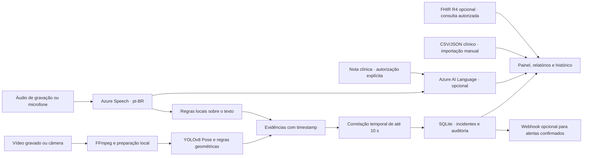

<!-- pt-BR -->
# Entrega — Tech Challenge | Fase 4

**Tema:** IA integrada aos processos médicos da instituição 
**Projeto:** Monitoramento multimodal de pacientes 
**Instituição:** FIAP

## Materiais da entrega

| Material | Acesso |
|---|---|
| Repositório com o código-fonte | [Fiap_Pos_9AIDT_Fase_04_Monitoramento_multimodal_pacientes](https://github.com/Etyonamine/Fiap_Pos_9AIDT_Fase_04_Monitoramento_multimodal_pacientes) |
| Vídeo de apresentação | [Assistir no YouTube](https://youtu.be/H27aF9EXlQk) |
| Relatório técnico completo | [relatorio-tecnico-multimodal.md](./relatorio-tecnico-multimodal.md) |
| Apresentação revisada | [Vigia-Saude-apresentacao-revisada.pptx](./Vigia-Saude-apresentacao-revisada.pptx) |
| Enunciado oficial | [IADT - Fase 4 - Tech challenge.pdf](./IADT%20-%20Fase%204%20-%20Tech%20challenge.pdf) |

## Resumo executivo

O projeto implementa um protótipo multimodal para analisar vídeo e áudio e
reunir evidências de uma mesma sessão. O vídeo é processado localmente com
YOLOv8 Pose e regras geométricas; a fala é transcrita com Azure Speech e
examinada por regras locais. Azure AI Language pode analisar sentimento e
termos-chave do texto. Incidentes de imagem e fala podem ser correlacionados
por proximidade temporal e consultados em histórico auditável.

A solução é um **protótipo de apoio à revisão**, não um dispositivo clínico.
Os testes e as demonstrações descritos neste documento usam mídia, inferências
ou sensores simulados; não demonstram acurácia clínica nem atendimento de uma
equipe médica.

Atualização do protótipo: há um simulador adicional de sinais e prescrição
vinculado à sessão de câmera ou reprodução, com comparação temporal às
evidências de imagem/fala e envio a um receptor sintético local. A comparação
acústica acrescentada também é experimental e não detecta condições médicas.
Esses fluxos não equivalem a sensores, identidade clínica, alertas à equipe
real ou validação clínica. O vídeo e os PDFs anteriores precisam ser revisados
e atualizados separadamente para refletir esta versão.

O painel também aceita importação manual de CSV/JSON com séries de sinais
vitais e histórico de prescrições, além de uma nota clínica JSON desidentificada
com autorização explícita para envio do texto ao Azure AI Language. Há consulta
FHIR R4 manual e webhook opcionais, ambos testados com serviços sintéticos
locais. A aplicação não remove identificadores automaticamente. Ainda não há
sensores conectados, prontuário institucional ou destinatário de equipe reais
verificados, nem correlação de identidade entre importações distintas. Os nomes
dos arquivos importados e resultados derivados ficam no SQLite local; use nomes
sem identificadores pessoais.

## Fluxo e componentes

### Métodos por modalidade

| Dado | Método ou serviço | Uso e limites |
|---|---|---|
| Vídeo e imagem | YOLOv8 Pose com pesos locais | Estima keypoints corporais. As regras calculam ângulos e acompanham o sujeito; não classificam quedas ou condições clínicas. |
| Leito | Cerca virtual baseada no ponto médio dos quadris | Registra evento quando o sujeito acompanhado sai do retângulo configurado. Isso não comprova queda ou emergência. |
| Fisioterapia | Regras geométricas sobre keypoints | Exemplos de limites configuráveis: tronco acima de 35°, joelho abaixo de 60° e elevação do tronco acima de 15° em relação à referência deitada. São heurísticas 2D; a postura é informada pelo usuário. |
| Áudio e fala | Azure Speech SDK, reconhecimento contínuo em `pt-BR` | Produz transcrição e tempos dos trechos. A consulta apresenta estimativas de palavras por minuto e pausas com base na transcrição/segmentação, não em diagnóstico ou avaliação acústica de disartria/fadiga. |
| Texto reconhecido | Regras lexicais locais | Sinaliza menções como falta de ar, dor no peito, socorro, cansaço e fadiga, com tentativa heurística de reconhecer negação. Pode gerar falsos positivos e negativos. |
| Texto de consulta | Azure AI Language / Text Analytics v3.1 | Extrai sentimento do texto e termos-chave quando configurado. Sentimento textual não representa emoção vocal ou condição clínica. |
| Sinal acústico | Cálculos locais de energia, silêncio e saturação | Apresenta indicadores para revisão da gravação; não são detectores validados de fadiga ou dificuldade respiratória. |
| Sinais vitais e prescrições | Importação manual CSV/JSON ou consulta FHIR R4 opcional | Há validação e regras fixas para revisão, mas os exemplos são sintéticos; FHIR foi testado localmente, não há sensores conectados nem validação de dose, indicação ou interação. |
| Nota clínica | JSON com texto enviado ao Azure AI Language após autorização | O original não é persistido localmente; sentimento e menções não são diagnóstico. |
| Notificação | Webhook opcional com fila e chave de idempotência | Testado com destinatário local sintético; resposta 2xx não comprova comunicação com uma equipe nem atendimento. |

## Resultados documentados

- **Testes E2E:** 6 de 6 passaram em Chromium, cobrindo gravação de leito com
  incidente imagem–fala e histórico, análise de fisioterapia e relatório,
  importação de consulta com consentimento, câmera/microfone simulados e
  importação dos exemplos clínicos sintéticos, além de FHIR e webhook locais.
- **Testes locais:** 341 backend, 112 Angular e 4 AudioWorklet passaram.
- **Cobertura de código registrada:** backend da aplicação 92,81% de linhas e 86,21% de
  branches; frontend Angular e templates 90,69% e 81,54%, respectivamente.
  Cobertura mede execução de código, não qualidade preditiva dos modelos.
- **Azure real:** Speech e AI Language retornaram respostas a um WAV e texto
  sintéticos, respectivamente, em verificação pontual separada dos testes
  automatizados. Não demonstra desempenho clínico ou implantação em Azure.
- **Avaliador offline sintético:** com tolerância temporal de 0,5 s, o exemplo
  produziu TP=2, FP=1, FN=1, precisão=0,667, recall=0,667, F1=0,667,
  WER=0,4 e MAE angular=2,5°. Esses valores verificam o cálculo das métricas;
  não são resultados de YOLO ou dos serviços Azure em mídia real.
- **Exemplos funcionais:** saída da cerca, menção crítica de fala, correlação
  imagem–fala na mesma sessão em até 10 s, regras geométricas de fisioterapia
  e indicadores de qualidade de áudio.

## Conferência dos requisitos do Tech Challenge

Esta conferência compara o enunciado, o código e o relatório técnico
disponíveis no repositório. “Parcial” indica que há uma demonstração ou parte
da funcionalidade, mas não todo o requisito conforme descrito. A conferência
documental não substitui validação clínica, verificação de serviços hospitalares
ou revisão integral do vídeo de apresentação.

| Requisito do enunciado | Situação | Evidência e observação |
|---|---|---|
| Analisar vídeos clínicos e detectar movimentos ou eventos fora do padrão | **Parcial** | Há análise de fisioterapia por pose e evento de saída da cerca em leito. Não há classificação específica de cirurgia ou validação clínica das anomalias. |
| Gerar relatórios automáticos de desvios ou falhas | **Atendido parcialmente** | A fisioterapia permite baixar relatório JSON com eventos. Os desvios são heurísticos e não validam execução clínica. |
| Processar áudio de consultas médicas | **Implementado no código** | O fluxo importa áudio, exige consentimento e integra Speech; os testes E2E usam reconhecimento simulado. |
| Detectar alterações vocais, como fadiga ou disartria | **Parcial / não comprovado como análise vocal** | Há regras sobre palavras transcritas e indicadores acústicos gerais. Fadiga mencionada no texto não equivale a detecção acústica de fadiga, e não há detecção de disartria demonstrada. |
| Usar Azure Speech e Azure Text Analytics/AI Language | **Implementado; conectividade real pontual verificada** | Speech e Language responderam a áudio e texto sintéticos; os testes automatizados usam simulações. Não há comprovação de desempenho clínico ou operação contínua. |
| Detectar anomalias em sinais vitais, prescrições e evolução clínica | **Parcial, somente demonstrativo** | Há importação de séries e prescrições CSV/JSON, consulta FHIR opcional e nota com autorização. Regras são genéricas; não há sensores ou prontuário real verificados, identidade vinculável ou validação clínica. |
| Alertar a equipe médica em tempo real | **Parcial; notificação à equipe não comprovada** | Um webhook opcional envia aviso genérico de alertas críticos confirmados e foi testado em loopback. Ainda não há destinatário da equipe, garantia de latência ou atendimento verificados. |
| Analisar e fundir dados médicos de texto, áudio e vídeo | **Parcial** | A aplicação correlaciona evidências visuais e fala transcrita. Não há ingestão/fusão de laudos e documentos clínicos como fontes reais. |
| Usar serviços em nuvem para ampliar processamento e inteligência | **Parcial** | Speech e Language são integrados como serviços Azure; a inferência YOLO é local. Não há evidência de implantação integral ou de processamento de vídeo na nuvem. |
| Aplicar detecção de anomalias em tempo real | **Parcial** | Há análise durante reprodução e demonstração de câmera; não há garantia de latência clínica ou integração de sinais vitais reais. |
| Disponibilizar o código-fonte completo em repositório Git | **Atendido, conforme material disponível** | O repositório do projeto está indicado acima. |
| Entregar relatório técnico com fluxo multimodal, modelos, resultados e exemplos | **Atendido** | Esses tópicos constam no [relatório técnico](./relatorio-tecnico-multimodal.md). |
| Entregar vídeo público ou não listado, com até 15 minutos e demonstração dos fluxos solicitados | **Link presente; conteúdo não verificado integralmente** | A duração observada foi 12min57s, abaixo do limite. Ainda é necessário conferir visibilidade, conteúdo completo e demonstração das alterações posteriores. |

### Pendências prioritárias frente ao enunciado

1. Configurar e verificar, com autorização institucional, um destinatário real
   para o webhook, sua autenticação, deduplicação, fluxo de resposta e latência.
   O recebimento técnico isolado não comprova atendimento.
2. Conectar e validar fontes reais autorizadas de sinais e prontuário, incluindo
   compatibilidade do servidor FHIR e associação segura de identidades. As
   regras e a massa atual permanecem demonstrativas.
3. Repetir e registrar a verificação de Azure Speech e Language no ambiente
   final sem expor chaves; a verificação pontual já realizada não garante
   disponibilidade contínua.
4. Confirmar que o vídeo está público ou não listado, tem no máximo 15 minutos
   e apresenta análise de áudio e vídeo, resposta a anomalias, integração Azure
   e o fluxo final de alerta exigido no enunciado.
5. Para alegações de desempenho clínico, realizar avaliação futura com mídia
   autorizada/desidentificada, rótulos independentes e predições reais. O
   avaliador já existente e seus exemplos sintéticos não substituem essa etapa.

## Configuração segura do Azure

Para a execução local, copie `backend/.env.example` para `backend/.env` e
configure as variáveis abaixo com credenciais dos recursos correspondentes:

| Variável | Finalidade |
|---|---|
| `AZURE_SPEECH_KEY` | Chave do recurso Azure Speech |
| `AZURE_SPEECH_REGION` | Região do recurso Azure Speech |
| `AZURE_LANGUAGE_KEY` | Chave do recurso Azure AI Language |
| `AZURE_LANGUAGE_ENDPOINT` | Endpoint HTTPS do recurso Azure AI Language |
| `FHIR_BASE_URL`, `FHIR_BEARER_TOKEN` | Consulta FHIR opcional, quando houver servidor autorizado |
| `ALERT_WEBHOOK_ENABLED`, `ALERT_WEBHOOK_URL`, `ALERT_WEBHOOK_BEARER_TOKEN` | Webhook opcional; desativado por padrão |

Não publique o arquivo `.env` nem inclua chaves neste documento, no repositório
ou no vídeo. Consulte o [README do projeto](../README.md) para detalhes de
configuração, execução e verificação. A configuração local não equivale a
provisionamento ou implantação da aplicação no Azure.

> **Atenção:** se credenciais reais foram compartilhadas anteriormente ou
> incluídas em arquivos versionados, revogue-as no Azure, gere novas e verifique
> também os PDFs de entrega antes de distribuí-los.

## Referências

- [Relatório técnico completo](./relatorio-tecnico-multimodal.md)
- [Enunciado do Tech Challenge](./IADT%20-%20Fase%204%20-%20Tech%20challenge.pdf)
- [README do repositório](../README.md)
