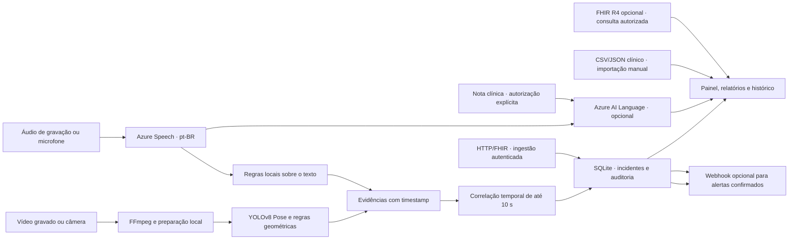

<!-- pt-BR -->
# Entrega — Tech Challenge | Fase 4

**Tema:** IA integrada aos processos médicos da instituição 
**Projeto:** Monitoramento multimodal de pacientes 
**Instituição:** FIAP

## Materiais da entrega

| Material | Acesso |
|---|---|
| Repositório com o código-fonte | [Fiap_Pos_9AIDT_Fase_04_Monitoramento_multimodal_pacientes](https://github.com/Etyonamine/Fiap_Pos_9AIDT_Fase_04_Monitoramento_multimodal_pacientes) |
| Vídeo de apresentação | [Assistir no YouTube](https://youtu.be/gkAbvW0j7qo) |
| Relatório técnico completo | [relatorio-tecnico-multimodal.md](./relatorio-tecnico-multimodal.md) |
| Apresentação revisada | [Vigia-Saude-apresentacao-revisada.pptx](./Vigia-Saude-apresentacao-revisada.pptx) |
| Enunciado oficial | [IADT - Fase 4 - Tech challenge.pdf](./IADT%20-%20Fase%204%20-%20Tech%20challenge.pdf) |

## Resumo executivo

O projeto implementa um protótipo multimodal para analisar vídeo e áudio e
reunir evidências de uma mesma sessão. O vídeo é processado localmente com
YOLOv8 Pose e regras geométricas; a fala é transcrita com Azure Speech e
examinada por regras locais. Azure AI Language pode analisar sentimento e
termos-chave do texto. Incidentes de imagem e fala podem ser correlacionados
por proximidade temporal e consultados em histórico auditável.

A solução é um **protótipo de apoio à revisão**, não um dispositivo clínico.
Os testes e as demonstrações descritos neste documento usam mídia, inferências
ou sensores simulados; não demonstram acurácia clínica nem atendimento de uma
equipe médica.
O endpoint de consulta da ingestão contínua também não implementa autenticação
de usuário; não exponha a aplicação em rede não confiável nem use dados reais
sem controles institucionais de acesso e transporte seguro.

Atualização do protótipo: além do simulador, há uma API autenticada para
ingestão contínua HTTP e recepção de Bundles FHIR R4 em uma sessão de mídia
ativa. As amostras podem ser correlacionadas temporalmente com evidências da
mesma sessão e gerar eventos genéricos para a fila de webhook. Há também uma
comparação acústica exploratória com gravação de referência. Essas capacidades
não equivalem a sensores ou prontuário institucional conectados, identidade
clínica, detecção vocal validada ou alertas recebidos por equipe real. O vídeo
publicado não foi avaliado nesta etapa, conforme o escopo solicitado.

O painel também aceita importação manual de CSV/JSON com séries de sinais
vitais e histórico de prescrições, além de uma nota clínica JSON desidentificada
com autorização explícita para envio do texto ao Azure AI Language. A consulta
FHIR R4 manual e contínua e o webhook opcional foram exercitados localmente
com dados/serviços sintéticos. A aplicação não remove identificadores
automaticamente. Ainda não há sensores conectados, prontuário institucional ou
destinatário de equipe reais verificados, nem correlação de identidade entre
importações distintas. Os nomes dos arquivos importados e resultados derivados
ficam no SQLite local; use nomes sem identificadores pessoais.

## Fluxo e componentes

### Métodos por modalidade

| Dado | Método ou serviço | Uso e limites |
|---|---|---|
| Vídeo e imagem | YOLOv8 Pose com pesos locais | Estima keypoints corporais. As regras calculam ângulos e acompanham o sujeito; não classificam quedas ou condições clínicas. |
| Leito | Cerca virtual baseada no ponto médio dos quadris | Registra evento quando o sujeito acompanhado sai do retângulo configurado. Isso não comprova queda ou emergência. |
| Fisioterapia | Regras geométricas sobre keypoints | Exemplos de limites configuráveis: tronco acima de 35°, joelho abaixo de 60° e elevação do tronco acima de 15° em relação à referência deitada. São heurísticas 2D; a postura é informada pelo usuário. |
| Áudio e fala | Azure Speech SDK, reconhecimento contínuo em `pt-BR` | Produz transcrição e tempos dos trechos. A consulta apresenta estimativas de palavras por minuto e pausas com base na transcrição/segmentação, não em diagnóstico ou avaliação acústica de disartria/fadiga. |
| Texto reconhecido | Regras lexicais locais | Sinaliza menções como falta de ar, dor no peito, socorro, cansaço e fadiga, com tentativa heurística de reconhecer negação. Pode gerar falsos positivos e negativos. |
| Texto de consulta | Azure AI Language / Text Analytics v3.1 e regras locais | Extrai sentimento e termos-chave; associa a frase-chave a uma menção da regra no trecho de origem, preservando a negação. A classificação de criticidade é local, não uma classificação clínica do Azure. |
| Sinal acústico | Energia, pitch exploratório, cruzamentos por zero e comparação com gravação de referência | Apresenta mudanças medidas e menções textuais não negadas como evidências independentes. Não detecta fadiga, disartria ou dificuldade respiratória. |
| Sinais vitais e prescrições | Importação manual, API HTTP autenticada e Bundles FHIR R4 | Há regras genéricas para revisão e comparação com referência fornecida por registro, quando existente. Não há sensores/prontuário institucional conectados nem validação de dose, indicação ou interação. |
| Nota clínica | JSON com texto enviado ao Azure AI Language após autorização | O original não é persistido localmente; sentimento e menções não são diagnóstico. |
| Notificação | Webhook opcional com fila e chave de idempotência | Recebe alertas de mídia confirmados e eventos clínicos genéricos da ingestão contínua. Testado com destinatário local sintético; resposta 2xx não comprova comunicação com uma equipe nem atendimento. |

## Resultados documentados

- **Testes E2E:** 6 de 6 passaram em Chromium, cobrindo gravação de leito com
  incidente imagem–fala e histórico, análise de fisioterapia e relatório,
  importação de consulta com consentimento, câmera/microfone simulados e
  importação dos exemplos clínicos sintéticos, além de FHIR e webhook locais.
  O cenário de câmera também verifica a ingestão autenticada do Bundle FHIR,
  o mapeamento para o tempo da sessão, a evidência de mídia correspondente e
  a entrega do evento genérico ao webhook sintético.
- **Validação local:** a suíte backend, os testes Angular e AudioWorklet e os
  seis cenários E2E são executados pelos comandos do [README](../README.md#como-executar-os-testes-no-windows).
  O E2E de voz compara tons sintéticos e exibe a transcrição simulada ao lado
  das medidas acústicas reais; o de fisioterapia exige um evento específico
  no relatório, não apenas uma lista de eventos. Um teste unitário adicional
  reproduz edição do limite enquanto a resposta de status está atrasada e
  exige que o valor 150° sobreviva e seja enviado, eliminando a sobrescrita
  assíncrona observada no E2E. Aceite: `preserves threshold edits made while a
  delayed selection status is pending` em [video-workspace.spec.ts](../frontend/src/app/video/video-workspace.spec.ts).
- **Correções posteriores revalidadas localmente:** a origem temporal da
  câmera agora é imutável, eventos antes da origem do vídeo são rejeitados
  mesmo em reprodução com deslocamento e cada Bundle FHIR é integralmente
  confirmado ou revertido numa transação. A suíte local completa após as
  correções passou; a CI precisa executar novamente neste commit de trabalho.
- **Build Angular:** concluído; permaneceram avisos de orçamento SCSS em
  `telemetry.scss` e `video-workspace.scss`.
- **Cobertura de código:** o gate verifica linhas e branches por módulo e
  totais, sem reduzir os pisos. Consulte o [README](../README.md#limites-de-cobertura)
  para os resultados da última execução local. Cobertura mede execução de
  código, não qualidade preditiva dos modelos.
- **Azure real:** Speech e AI Language retornaram respostas a um WAV e texto
  sintéticos, respectivamente, em verificação pontual separada dos testes
  automatizados. Não demonstra desempenho clínico ou implantação em Azure.
- **Avaliador offline sintético:** com tolerância temporal de 0,5 s, o exemplo
  produziu TP=2, FP=1, FN=1, precisão=0,667, recall=0,667, F1=0,667,
  WER=0,4 e MAE angular=2,5°. Esses valores verificam o cálculo das métricas;
  não são resultados de YOLO ou dos serviços Azure em mídia real.
- **Exemplos funcionais:** saída da cerca, menção crítica de fala, correlação
  imagem–fala na mesma sessão em até 10 s, regras geométricas de fisioterapia
  e indicadores de qualidade de áudio.

## Conferência e critérios fixos de aceite

**Demonstrado no protótipo** significa que a entrada e a saída abaixo são
verificadas pelo teste indicado, usando as simulações explicitadas. Isso não
significa desempenho clínico. **Ausente** identifica capacidade que o código
não fornece; uma futura integração institucional é tratada separadamente e não
é presumida como exigência para executar o protótipo acadêmico. A análise do
vídeo de apresentação está fora do escopo atual.

1. **Movimento em fisioterapia e relatório — demonstrado.** Entrada: vídeo
   preto de dois segundos com keypoints sintéticos de pessoa em pé e limite
   experimental do joelho configurado em 150°. Saída: relatório JSON com modo,
   postura, limite, aviso de não diagnóstico e evento
   `Ângulo interno do joelho < 150°` com severidade `warning`. Aceite: teste
   `synthetic physiotherapy frames produce a measurable deviation in the downloaded report`
   em [solution.spec.ts](../frontend/e2e/solution.spec.ts). O limite é apenas
   escolhido para o teste; não é recomendação clínica. A inferência YOLO é
   simulada, portanto esse caso não mede detecção em vídeo real. A regressão
   `preserves threshold edits made while a delayed selection status is pending`
   em [video-workspace.spec.ts](../frontend/src/app/video/video-workspace.spec.ts)
   reproduz a edição durante uma resposta tardia e exige que 150° sobreviva e
   seja o valor enviado, cobrindo a instabilidade observada.
2. **Áudio de consulta e variação acústica — demonstrado como comparação
   exploratória.** Entrada: tons de referência de 180 Hz e corrente de 330 Hz,
   com segmentos e transcrição “Estou com falta de ar.” simulados. Saída:
   variação de pitch acima do limiar exploratório, menção não negada exibida
   separadamente e aviso de que a coexistência não demonstra causalidade.
   Aceite: `synthetic audio acceptance measures a voice change alongside simulated Speech and Language`
   em [solution.spec.ts](../frontend/e2e/solution.spec.ts) e
   `test_synthetic_voice_acceptance_uses_measured_audio_and_separate_transcript`
   em [test_audio.py](../backend/tests/test_audio.py). O cálculo acústico é
   real; os tons não são fala e o reconhecimento é simulado.
3. **Detecção vocal demonstrativa — implementada somente para perfis acústicos
   artificiais; detecção clínica ausente.** Entrada: diferenças acústicas
   já medidas entre gravação corrente e referência, sem receber rótulo de
   condição. Saída: `pitch_shift`, `energy_change`, `pitch_variation_change`,
   `spectral_change`, `multiple_acoustic_changes`, `control_like` ou
   `abstain`, com aviso explícito de que os rótulos não são condições clínicas.
   Aceite: `test_synthetic_voice_profile_detects_only_artificial_acoustic_changes`
   e `test_synthetic_voice_profile_abstains_without_sufficient_audio` em
   [test_audio.py](../backend/tests/test_audio.py), além da apresentação e do
   aviso na interface em [voice.spec.ts](../frontend/src/app/voice/voice.spec.ts).
   Esses casos exercitam decisão determinística sobre medidas acústicas; não
   treinam nem avaliam um classificador de voz clínica. Detecção de fadiga,
   disartria ou dificuldade respiratória continua ausente e requer fala
   rotulada por profissionais, divisão por participante, avaliação externa,
   análise de vieses e validação institucional.
4. **Speech e análise de texto — integração implementada; aceites
   automatizados simulados.** Entrada: “Não tenho dor no peito. Relato falta
   de ar.” e respostas simuladas do Language com frases-chave. Saída: “dor
   no peito” negada, “falta de ar” não negada e sentimento textual; termos
   ausentes não são atribuídos ao texto. Aceite:
   `test_key_phrase_acceptance_preserves_negation_and_requires_text_match` em
   [test_audio.py](../backend/tests/test_audio.py). Azure extrai as frases e
   o sentimento; a criticidade e a negação são heurísticas locais. Uma chamada
   real pontual anterior a Speech e Language usou dados sintéticos; não é
   revalidação dos testes desta versão nem avaliação clínica.
5. **Sinais vitais — demonstrado.** Entrada: FC de 78 para 132 bpm e SpO₂ de
   97% para 88% no simulador da sessão. Saída: eventos de FC acima e SpO₂
   abaixo dos limites demonstrativos. Aceite: cenário de câmera em
   [solution.spec.ts](../frontend/e2e/solution.spec.ts) e
   `test_vitals_csv_import_detects_threshold_crossings_and_rapid_changes` em
   [test_clinical_data.py](../backend/tests/test_clinical_data.py).
6. **Prescrições e referência — demonstrado.** Entrada: dose observada de
   30 mg e referência sintética explícita de 10 mg; há também registros
   compatíveis, mudança prevista e ausência de referência. Saída: divergência
   no campo `dose` para revisão, mudança prevista informativa e ausência de
   referência marcada como não avaliada. Aceite: cenários de câmera e
   importação em [solution.spec.ts](../frontend/e2e/solution.spec.ts) e
   `test_prescription_acceptance_distinguishes_expected_unexpected_and_missing_plan`
   em [test_clinical_data.py](../backend/tests/test_clinical_data.py).
   Referência fornecida pela origem não é uma ordem institucional autenticada.
7. **Evolução textual no cenário sintético — demonstrada além da alternância
   fixa.** Entrada: notas sintéticas editáveis e sucessivas na mesma sessão,
   por exemplo “relata cansaço”, repetição do termo e depois “relata
   bem-estar”. Saída: estruturas derivadas de menções introduzidas, mantidas e
   resolvidas, com eventos explícitos; o texto original não é persistido.
   Aceite: `test_custom_notes_evolve_from_derived_mentions_without_persisting_text`
   em [test_synthetic_stream.py](../backend/tests/test_synthetic_stream.py) e
   `sends an editable synthetic note and renders derived evolution without
   source text` em [synthetic-stream.spec.ts](../frontend/src/app/video/synthetic-stream.spec.ts).
   O vínculo existe apenas dentro da sessão sintética. Não interpreta
   prontuários arbitrários, melhora/aggravamento clínico ou identidade.
8. **Fusão e alerta — demonstrados no protótipo.** Entrada: saída sintética
   da cerca, fala simulada próxima e uma amostra clínica autenticada na mesma
   sessão; outra amostra contém 30 mg frente à referência de 10 mg. Saída:
   incidente imagem–fala, correspondência temporal da amostra e entrega do
   evento genérico `unexpected_regimen` ao webhook local sintético. Aceite:
   cenário de câmera em [solution.spec.ts](../frontend/e2e/solution.spec.ts).
   A associação de até 10 s não comprova identidade ou causalidade, e o 2xx
   não comprova leitura ou atendimento por uma equipe.
9. **Uso de nuvem, repositório e relatório técnico.** Speech e Language
   estão integrados no código; os testes atuais substituem os serviços e não
   exigem implantação integral na nuvem. O código está no repositório indicado
   em “Materiais da entrega” e o [relatório técnico](./relatorio-tecnico-multimodal.md)
   documenta fluxo, métodos, resultados e limitações.

### Fora do protótipo demonstrado

- **Funcionalidade ausente:** detector vocal de fadiga/disartria/dificuldade
  respiratória; interpretação longitudinal geral e vínculo de identidade
  clínica entre importações independentes.
- **Para uso clínico ou institucional:** dados autorizados e rotulados,
  validação de modelos e limiares, identidade e segurança de acesso/HTTPS,
  compatibilidade real de sensores/FHIR, receptor de equipe com governança,
  confirmação operacional e avaliação de latência. O `GET` do fluxo clínico
  ainda não exige autenticação geral de usuário; não exponha o protótipo nem
  use dados reais sem os controles necessários.
- A [Microsoft informa](https://learn.microsoft.com/en-us/azure/ai-services/language-service/key-phrase-extraction/overview)
  a descontinuação da extração de frases-chave do Azure Language em
  **31/03/2029**; uma implantação duradoura precisará planejar a migração.

## Configuração segura do Azure

Para a execução local, copie `backend/.env.example` para `backend/.env` e
configure as variáveis abaixo com credenciais dos recursos correspondentes:

| Variável | Finalidade |
|---|---|
| `AZURE_SPEECH_KEY` | Chave do recurso Azure Speech |
| `AZURE_SPEECH_REGION` | Região do recurso Azure Speech |
| `AZURE_LANGUAGE_KEY` | Chave do recurso Azure AI Language |
| `AZURE_LANGUAGE_ENDPOINT` | Endpoint HTTPS do recurso Azure AI Language |
| `FHIR_BASE_URL`, `FHIR_BEARER_TOKEN` | Consulta FHIR opcional, quando houver servidor autorizado |
| `CLINICAL_INGEST_BEARER_TOKEN` | Token independente, com ao menos 32 caracteres, para ingestão HTTP/FHIR |
| `ALERT_WEBHOOK_ENABLED`, `ALERT_WEBHOOK_URL`, `ALERT_WEBHOOK_BEARER_TOKEN` | Webhook opcional; desativado por padrão |

Não publique o arquivo `.env` nem inclua chaves neste documento, no repositório
ou no vídeo. Consulte o [README do projeto](../README.md) para detalhes de
configuração, execução e verificação. A configuração local não equivale a
provisionamento ou implantação da aplicação no Azure.

> **Atenção:** se credenciais reais foram compartilhadas anteriormente ou
> incluídas em arquivos versionados, revogue-as no Azure, gere novas e verifique
> também os PDFs de entrega antes de distribuí-los.

## Referências

- [Relatório técnico completo](./relatorio-tecnico-multimodal.md)
- [Enunciado do Tech Challenge](./IADT%20-%20Fase%204%20-%20Tech%20challenge.pdf)
- [README do repositório](../README.md)
