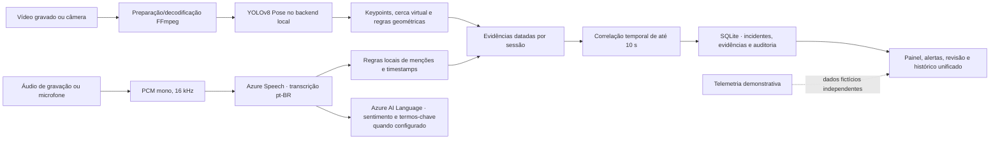

# Relatório técnico — monitoramento multimodal de pacientes

**Projeto:** Monitoramento multimodal de pacientes — FIAP, Fase 4  
**Data:** 14/11/2026  
**Escopo:** descrição do fluxo multimodal, métodos/modelos por tipo de dado e resultados de software e exemplos de anomalias implementadas.

> **Resumo executivo.** A solução combina análise de vídeo e fala com referências temporais para reunir evidências de uma mesma sessão. O vídeo é analisado localmente pelo YOLOv8 Pose e por regras geométricas; a fala é transcrita pelo Azure Speech e verificada por regras locais de menções. Para consultas de voz há também análise de sentimento e termos-chave pelo Azure AI Language. Incidentes de imagem e fala próximos no tempo são persistidos em histórico unificado e auditável. Os testes de integração demonstram esse fluxo com dados e inferências sintéticos; não medem acurácia em pacientes nem validam uso clínico.

## 1. Fluxo multimodal

### Vídeo de leito reproduzido

1. A gravação é importada e normalizada pelo FFmpeg para MP4 H.264/AAC e 25 fps; o áudio do vídeo não é interpretado antecipadamente como fala.  
2. Na reprodução, o frontend acompanha os instantes alcançados pelo player. O backend analisa os frames correspondentes com YOLOv8 Pose e envia ao Azure Speech somente os trechos de áudio que foram reproduzidos.  
3. Eventos de imagem e fala recebem timestamp da sessão. Um pedido de ajuda/fala crítica pode gerar alerta individual, assim como uma saída da cerca; a interface não aguarda a correlação para mostrar o alerta individual.

### Câmera e microfone

1. A prévia da câmera é local. Para iniciar a análise, é necessário salvar a cerca e autorizar câmera e microfone no navegador.  
2. Frames amostrados são enviados ao backend local para pose/cerca. O áudio é capturado pelo AudioWorklet, transmitido como PCM mono a 16 kHz e reconhecido pelo Azure Speech durante a sessão.  
3. Ao encerrar, evidências e histórico permanecem no SQLite; a gravação de mídia só é mantida se a opção de gravação estiver habilitada.

### Consulta de voz

1. A interface exige consentimento antes de permitir a seleção do áudio.  
2. FFmpeg converte a mídia para WAV PCM mono de 16 bits a 16 kHz, limitado a 100 MB e 30 minutos. Indicadores acústicos são calculados localmente.  
3. Azure Speech faz reconhecimento contínuo em pt-BR e fornece trechos com offsets e, quando disponíveis, confiança. Regras locais identificam menções e possíveis negações. Azure AI Language é usado para sentimento do **texto** e extração de termos-chave. Os resultados ficam disponíveis para revisão, sem alertar uma equipe externa.

### Correlação e histórico

- O serviço associa saída da cerca e fala crítica dentro da mesma sessão se os timestamps estiverem a até **10 segundos**. Quando há várias saídas próximas, usa a saída elegível temporalmente mais próxima como âncora; não encadeia correlações indefinidamente.
- Uma evidência individual continua sendo apresentada sem esperar por outra modalidade. Quando há evidência ativa de imagem e áudio, o incidente passa a ser multimodal.
- Incidentes, evidências, confirmação da ação de atendimento e versões anteriores são persistidos e consultáveis. A confirmação registra a ação no sistema, não comprova atendimento presencial.

## 2. Modelos e métodos por tipo de dado

| Dado | Modelo/serviço aplicado | Papel no sistema | O que não representa |
|---|---|---|---|
| Imagem/vídeo | **YOLOv8 Pose** da Ultralytics, com pesos Pose locais (`yolov8n-pose.pt`, configuráveis) | Detecta pessoas e estima keypoints corporais. O código calcula ângulos e acompanha o sujeito pela região dos quadris. | Não é um classificador clínico de quedas, dor ou execução correta. A solução não treina nem calibra o modelo com um conjunto clínico rotulado. |
| Vídeo de leito | Regras determinísticas sobre keypoints e cerca virtual | Gera evento crítico quando o ponto médio dos quadris do sujeito acompanhado sai do retângulo salvo. | Saída da cerca não comprova queda ou emergência. |
| Fisioterapia | Regras geométricas sobre keypoints do YOLO Pose | Ângulo do tronco acima do limite (padrão **35°**), ângulo interno do joelho abaixo do limite (padrão **60°**) e, em decúbito, elevação do tronco acima de **15°** em relação à referência inicial confiável. Limites são configuráveis. | São heurísticas de triagem por geometria 2D; não avaliam a coluna lombar nem identificam valgo do joelho. A postura é informada pelo usuário/intervalo, não inferida automaticamente. |
| Fala em vídeo/câmera | **Azure Speech SDK — Speech to Text**, reconhecimento contínuo em `pt-BR` | Converte fala em texto com tempos de segmentos; a transcrição é associada à linha temporal da sessão. | Não há diarização ou identificação de paciente/profissional. |
| Texto de fala (consulta, vídeo e câmera, quando configurado) | **Azure AI Language / Text Analytics v3.1** | Calcula sentimento e extrai key phrases do texto reconhecido; blocos longos são divididos em trechos e lotes. | Sentimento é do texto, não emoção/prosódia da voz nem avaliação de estado clínico. |
| Texto reconhecido | Regras lexicais locais versionadas | Sinaliza menções como “falta de ar”, “dor no peito”, “dispneia”, “socorro”, “cansaço” e “fadiga”; tenta distinguir negação no contexto próximo. | Não é modelo médico nem compreensão robusta de contexto; perguntas, hipóteses, histórico e negações complexas podem gerar falso positivo ou negativo. |
| Sinal acústico | Cálculos determinísticos de energia RMS, silêncio e saturação em janelas de 100 ms | Aponta condições de gravação que merecem revisão: baixa energia, pausas, clipping e, em gravações longas, redução de intensidade. | Não é um modelo de fadiga, respiração ou diagnóstico. Baixa energia pode ser silêncio, ruído, distância ou microfone. |
| Telemetria da interface | Dados de cenário gerados pela aplicação | Demonstra sinais vitais, alertas e prescrições fictícios para a apresentação. | Não são leituras de sensores físicos, não vêm do vídeo e não participam da inferência multimodal. |

O detector de pose usa confiança mínima de keypoints para calcular as métricas; quando faltam pontos confiáveis, a métrica é marcada indisponível em vez de inferir um valor. Para a regra de decúbito, a referência é inicializada pelo primeiro ângulo confiável do sujeito acompanhado em cada intervalo deitado.

## 3. Resultados obtidos

### Integração e testes automatizados

Na validação local registrada para esta versão:

- **4 de 4 testes E2E passaram** em Chromium, percorrendo as interfaces reais e os endpoints reais de um backend local isolado.
- Os fluxos exercitados foram: gravação de leito com incidente imagem–fala, confirmação e histórico/auditoria; envio de fisioterapia e download de relatório; importação de consulta com consentimento; câmera e microfone falsos com AudioWorklet, correlação e persistência após encerrar.
- O cenário E2E usa arquivos gerados localmente, inferência YOLO simulada, reconhecimento Speech simulado, sem credenciais Azure e com conexões externas bloqueadas. Portanto, os resultados demonstram integração funcional, não desempenho dos modelos.
- A medição de cobertura documentada é **90,06% linhas / 81,49% branches** para o backend da aplicação e **89,09% / 80,25%** para o frontend Angular e templates. São métricas de execução de código, não métricas de acurácia de IA.

### Demonstração sintética do avaliador offline

O avaliador compara rótulos de referência e predições JSON; os exemplos não contêm mídia nem são clínicos. Com tolerância temporal inclusiva de 0,5 s, a demonstração documentada produziu:

| Métrica sintética | Resultado |
|---|---:|
| Verdadeiros positivos (TP) | 2 |
| Falsos positivos (FP) | 1 |
| Falsos negativos (FN) | 1 |
| Precisão | 0,667 |
| Recall | 0,667 |
| F1 | 0,667 |
| WER de transcrição | 0,4 |
| MAE angular | 2,5° |

Esses números validam os cálculos do avaliador. **Não são resultados de YOLO, Azure Speech ou Azure AI Language em vídeo/áudio real.**

### Exemplos de anomalias e incidentes

| Modalidade / cenário | Exemplo de condição | Resultado esperado no sistema |
|---|---|---|
| Imagem de leito | O ponto médio dos quadris cruza para fora da cerca virtual habilitada. | Evento crítico **“Saída da cerca virtual”**, com timestamp e evidência de imagem. |
| Fala | O texto reconhecido contém “Estou com falta de ar.” ou “Preciso de ajuda.” | Menção crítica de fala, sujeita às regras locais de contexto/negação; é uma solicitação de revisão, não diagnóstico. |
| Imagem + fala | Uma saída da cerca e a fala crítica acontecem na mesma sessão dentro da janela de 10 s. | Um incidente unificado com evidências identificadas como imagem e fala, preservando os eventos individuais. |
| Fisioterapia em pé/sentado | Ângulo geométrico do tronco excede 35° ou o ângulo interno mínimo do joelho fica abaixo de 60°. | Evento de aviso com a regra e o limite; não afirma que o exercício está clinicamente incorreto. |
| Fisioterapia deitado | O tronco eleva mais que 15° em relação ao primeiro frame confiável de referência. | Evento de aviso **“Elevação do tronco em relação à posição inicial”**. |
| Qualidade do áudio | Pelo menos 40% das janelas ficam abaixo de RMS normalizado 0,02; há trecho de baixa energia ≥2 s; ou clipping alcança ≥1% das amostras. | Indicador para revisar a gravação. Em áudio ≥30 s, redução de intensidade ≥6 dB entre terços inicial/final também pode ser mostrada para revisão. |
| Fala negada | “Não tenho dor no peito.” | A regra pode marcar a menção como negada; essa heurística não cobre todas as formas de negação ou contexto. |

No E2E de leito, a implementação sintética posiciona inicialmente a pessoa dentro da cerca e a desloca para fora; o Speech sintético produz “Estou com falta de ar.”. A aplicação correlaciona as evidências próximas, permite registrar a ação no botão e consultar o histórico/auditoria. Isso demonstra o caminho funcional, não reconhecimento de uma pessoa real.

## 4. Limitações e interpretação

1. O projeto não está validado para diagnóstico, decisão clínica, prevenção de quedas ou acionamento de emergência. Os limiares geométricos e as regras de fala são demonstrativos.
2. Não há câmera ou sensores físicos disponíveis para a validação atual. Assim, o fluxo de câmera/microfone foi testado com dispositivos virtuais do Chromium; os valores de telemetria são simulados.
3. Um vídeo gerado por IA pode ilustrar os casos de demonstração, mas sem anotações independentes, controle do conjunto de teste e medição reproduzível não constitui validação da acurácia.
4. O avaliador real está implementado, mas a avaliação de modelos com dados rotulados permanece pendente. São necessários mídia autorizada/desidentificada, rótulos independentes e predições exportadas do modelo real.
5. O fluxo operacional com serviços reais requer pesos YOLO Pose disponíveis no backend e configuração válida de Azure Speech/Language, além de FFmpeg. A suíte automatizada deliberadamente não usa esses serviços externos.
6. São riscos conhecidos: oclusão, ângulo da câmera, iluminação, distância, baixa confiança dos keypoints, perda de frames, ruído e variação do microfone; menções lexicais podem falhar com contexto e negação.
7. Uma menção crítica ou evento de cerca é apresentada como evidência para revisão. Não notifica automaticamente equipe médica; o registro “Ir ao atendimento” representa apenas a ação no sistema.

## 5. Referências de implementação

- [YOLO Pose, geometria e cerca virtual](../backend/app/services/yolo_services.py)
- [Regras de áudio, transcrição e indicadores acústicos](../backend/app/services/audio_analysis.py)
- [Azure Speech e Azure AI Language](../backend/app/services/azure_service.py)
- [Streaming de fala e transcrição no monitoramento](../backend/app/services/live_audio.py)
- [Correlação temporal e persistência de incidentes](../backend/app/services/incidents.py)
- [Rotas de áudio](../backend/app/routers/audio.py)
- [Servidor E2E sintético e isolado](../backend/tests/e2e_server.py)
- [Especificação dos testes E2E](../frontend/e2e/solution.spec.ts)
- [Implementação do avaliador offline](../backend/evaluation/metrics.py)
- [Exemplos sintéticos do avaliador](../backend/evaluation/examples/references.json) e [predições correspondentes](../backend/evaluation/examples/predictions.json)
- [Documento do Tech Challenge incluído no repositório](IADT%20-%20Fase%204%20-%20Tech%20challenge.pdf)
