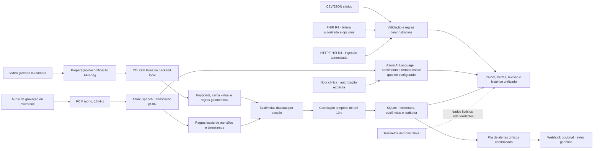

# Relatório técnico — monitoramento multimodal de pacientes

**Projeto:** Monitoramento multimodal de pacientes — FIAP, Fase 4  
**Data:** novembro de 2026 
**Escopo:** descrição do fluxo multimodal, métodos/modelos por tipo de dado e resultados de software e exemplos de anomalias implementadas.

> **Resumo executivo.** A solução combina análise de vídeo e fala com referências temporais para reunir evidências de uma mesma sessão. O vídeo é analisado localmente pelo YOLOv8 Pose e por regras geométricas; a fala é transcrita pelo Azure Speech e verificada por regras locais de menções. Uma API autenticada recebe amostras clínicas HTTP e Bundles FHIR R4 para sessões ativas; regras demonstrativas correlacionam esses dados por sessão/tempo e podem encaminhar eventos genéricos a um webhook desativado por padrão. A comparação acústica entre gravações também é exploratória. Chamadas reais pontuais a Speech e Language usaram somente dados sintéticos; a ingestão e o webhook foram exercitados localmente. Isso não mede acurácia em pacientes, não prova uma assinatura FHIR institucional e não valida uso clínico.

## 1. Fluxo multimodal

### Vídeo de leito reproduzido

1. A gravação é importada e normalizada pelo FFmpeg para MP4 H.264/AAC e 25 fps; o áudio do vídeo não é interpretado antecipadamente como fala.  
2. Na reprodução, o frontend acompanha os instantes alcançados pelo player. O backend analisa os frames correspondentes com YOLOv8 Pose e envia ao Azure Speech somente os trechos de áudio que foram reproduzidos.  
3. Eventos de imagem e fala recebem timestamp da sessão. Um pedido de ajuda/fala crítica pode gerar alerta individual, assim como uma saída da cerca; a interface não aguarda a correlação para mostrar o alerta individual.

### Câmera e microfone

1. A prévia da câmera é local. Para iniciar a análise, é necessário salvar a cerca e autorizar câmera e microfone no navegador.  
2. Frames amostrados são enviados ao backend local para pose/cerca. O áudio é capturado pelo AudioWorklet, transmitido como PCM mono a 16 kHz e reconhecido pelo Azure Speech durante a sessão.  
3. Ao encerrar, evidências e histórico permanecem no SQLite; a gravação de mídia só é mantida se a opção de gravação estiver habilitada.

### Consulta de voz

1. A interface exige consentimento antes de permitir a seleção do áudio.  
2. FFmpeg converte a mídia para WAV PCM mono de 16 bits a 16 kHz, limitado a 100 MB e 30 minutos. Indicadores acústicos são calculados localmente.  
3. Azure Speech faz reconhecimento contínuo em pt-BR e fornece trechos com offsets e, quando disponíveis, confiança. Regras locais identificam menções e possíveis negações. A aplicação calcula estimativa descritiva de palavras por minuto e pausas usando os tempos/textos dos segmentos reconhecidos. Azure AI Language é usado para sentimento do **texto** e extração de termos-chave. Os resultados ficam disponíveis para revisão, sem alertar uma equipe externa.
4. Uma comparação experimental com uma gravação escolhida pelo operador compara pitch mediano/faixa, energia RMS e cruzamentos por zero nos trechos reconhecidos como fala. Requer duração/energia suficientes e rejeita saturação excessiva. Não separa voz de ruído, não controla conteúdo/microfone, não foi avaliada em base clínica e não detecta fadiga, disartria ou dificuldade respiratória.

### Séries, prescrições e nota clínica importadas

- Sinais vitais são importados manualmente por CSV/JSON. O backend valida timestamps com fuso, pseudônimos e faixas de entrada, ordena os pontos e aplica limites genéricos e diferenças entre pontos próximos. Eventos são exibidos como pedidos de revisão, não como anomalias clínicas validadas.
- Prescrições são comparadas por pseudônimo e medicamento dentro de cada arquivo para identificar início, mudança de regime, interrupção e retomada. A aplicação não valida dose, interação, indicação ou ordem.
- Nota clínica JSON desidentificada só é processada se a interface enviar `consent_to_cloud=true` e Azure AI Language estiver configurado. A aplicação não remove automaticamente identificadores: o texto é enviado para termos-chave/sentimento, mas não é persistido no SQLite; ficam apenas métricas e menções derivadas. Falha de serviço não grava o resultado.
- Cada importação recebe pseudônimos próprios, não vinculáveis automaticamente entre arquivos. A linha do tempo reúne esses eventos com vídeo/áudio para revisão, mas não faz correlação de identidade ou de prescrição com sinais vitais. Não há conexão direta com sensores.
- A ingestão contínua HTTP recebe amostras autenticadas com `sample_id`, pseudônimo estável da fonte, horário ISO 8601, tempo da sessão e sinais/prescrições. Exige sessão de mídia existente e ativa, rejeita dados fora de ordem e mantém até 1.000 amostras por fonte/sessão. As regras geram eventos de revisão, não decisões clínicas.
- Os nomes dos arquivos e os resultados derivados também ficam no SQLite local; use nomes sem identificadores pessoais e proteja os dados armazenados.
- A massa de demonstração em `backend/evaluation/examples/` inclui 96 pontos sintéticos por 24 h, cinco registros de prescrição e uma nota sintética. Esses arquivos exercitam formato, validação, regra e interface; não são dados de pacientes, evidência clínica ou base para ajustar limiares.

### FHIR R4 e notificação opcional

Além da consulta manual, um produtor autorizado pode enviar Bundles
`collection`/`history` autenticados a uma sessão ativa, com associação ao
pseudônimo fornecido e validação de sujeito. O endpoint recebe dados de uma
assinatura previamente configurada, mas não cria nem administra a assinatura
no servidor FHIR. O `GET` do fluxo retorna amostras recentes sem exigir o token
de ingestão; como o protótipo não tem autenticação geral de usuário, deve
permanecer em rede confiável e não deve receber dados reais até existir
controle institucional de acesso e HTTPS.

No mapeamento temporal corrigido, a sessão de câmera mantém como origem o
`started_at` registrado pelo servidor, que não pode ser substituído pelo
produtor. Na reprodução, `session_origin_at` representa o timestamp de origem
do vídeo e o deslocamento `start` é somado ao intervalo. Um evento anterior à
origem é rejeitado antes da soma do deslocamento. Todo o Bundle é persistido
em uma única transação; falha de qualquer amostra reverte também as amostras e
notificações anteriores daquele Bundle.

Eventos de revisão gerados pela ingestão contínua também podem entrar na fila
do webhook. Os payloads clínicos são genéricos e omitem valores vitais,
medicamento, identificadores institucionais, transcrição e nota; a entrega
configurada continua sem comprovar recebimento ou atendimento da equipe.

- A consulta FHIR é manual, somente leitura e requer confirmação de autorização, URL e token Bearer no backend. Importa observações com LOINC/UCUM reconhecidos e `MedicationRequest` para revisão. O identificador é transmitido ao servidor FHIR configurado, mas não é gravado no histórico local. Valores ausentes não são estimados; doses complexas e recursos incompatíveis geram avisos. As ordens não demonstram administração ou histórico de versões.
- Um webhook desativado por padrão pode ser habilitado para novos alertas críticos confirmados de imagem/fala em sessões de leito. A gravação do alerta e da fila é transacional; o envio ocorre depois, com Bearer e chave de idempotência. O corpo não contém identificador de paciente ou transcrição. Falhas e tentativas são visíveis, com repetição automática limitada e possibilidade de repetição manual.
- A entrega é pelo menos uma vez; o destino deve deduplicar. Um HTTP 2xx não comprova que a equipe leu a mensagem ou realizou atendimento. O teste ponta a ponta usa servidor FHIR e destinatário de webhook sintéticos em loopback; ainda não há endpoint institucional, dispositivos ou receptor de equipe reais verificados.

### Correlação e histórico

- O serviço associa saída da cerca e fala crítica dentro da mesma sessão se os timestamps estiverem a até **10 segundos**. Quando há várias saídas próximas, usa a saída elegível temporalmente mais próxima como âncora; não encadeia correlações indefinidamente.
- Um simulador separado gera sinais vitais, mudanças de prescrição e nota textual sintéticos ao longo de uma sessão de câmera ou reprodução explicitamente selecionada. As menções da nota usam regras locais. Evidências ativas de imagem/fala da mesma sessão podem ser apresentadas junto às amostras dentro de 10 s. Um webhook em loopback recebe avisos genéricos desse simulador, com estado e repetição manual. Não há associação de identidade real, prova de causalidade, sensor conectado ou equipe destinatária.
- Para ingestão HTTP/FHIR, a aplicação associa evidências ativas de mídia à amostra da mesma sessão quando os horários de sessão diferem em até 10 s. O identificador de fonte é pseudônimo e não estabelece identidade entre sistemas; correlação temporal não prova que os sinais pertencem à pessoa filmada.
- Uma evidência individual continua sendo apresentada sem esperar por outra modalidade. Quando há evidência ativa de imagem e áudio, o incidente passa a ser multimodal.
- Incidentes, evidências, confirmação da ação de atendimento e versões anteriores são persistidos e consultáveis. A confirmação registra a ação no sistema, não comprova atendimento presencial.

## 2. Modelos e métodos por tipo de dado

| Dado | Modelo/serviço aplicado | Papel no sistema | O que não representa |
|---|---|---|---|
| Imagem/vídeo | **YOLOv8 Pose** da Ultralytics, com pesos Pose locais (`yolov8n-pose.pt`, configuráveis) | Detecta pessoas e estima keypoints corporais. O código calcula ângulos e acompanha o sujeito pela região dos quadris. | Não é um classificador clínico de quedas, dor ou execução correta. A solução não treina nem calibra o modelo com um conjunto clínico rotulado. |
| Vídeo de leito | Regras determinísticas sobre keypoints e cerca virtual | Gera evento crítico quando o ponto médio dos quadris do sujeito acompanhado sai do retângulo salvo. | Saída da cerca não comprova queda ou emergência. |
| Fisioterapia | Regras geométricas sobre keypoints do YOLO Pose | Ângulo do tronco acima do limite (padrão **35°**), ângulo interno do joelho abaixo do limite (padrão **60°**) e, em decúbito, elevação do tronco acima de **15°** em relação à referência inicial confiável. Limites são configuráveis. | São heurísticas de triagem por geometria 2D; não avaliam a coluna lombar nem identificam valgo do joelho. A postura é informada pelo usuário/intervalo, não inferida automaticamente. |
| Fala em vídeo/câmera | **Azure Speech SDK — Speech to Text**, reconhecimento contínuo em `pt-BR` | Converte fala em texto com tempos de segmentos; a transcrição é associada à linha temporal da sessão. | Não há diarização ou identificação de paciente/profissional. |
| Texto de fala (consulta, vídeo e câmera, quando configurado) | **Azure AI Language / Text Analytics v3.1** | Calcula sentimento e extrai key phrases do texto reconhecido; blocos longos são divididos em trechos e lotes. | Sentimento é do texto, não emoção/prosódia da voz nem avaliação de estado clínico. |
| Texto reconhecido | Regras lexicais locais versionadas | Sinaliza menções como “falta de ar”, “dor no peito”, “dispneia”, “socorro”, “cansaço” e “fadiga”; tenta distinguir negação no contexto próximo. | Não é modelo médico nem compreensão robusta de contexto; perguntas, hipóteses, histórico e negações complexas podem gerar falso positivo ou negativo. |
| Sinal acústico | Energia RMS, pitch/faixa exploratórios e cruzamentos por zero, comparados entre duas gravações | Compara trechos reconhecidos como fala após seleção manual de uma referência; limiares são exploratórios. | Não separa voz de ruído nem é modelo ou detector validado de fadiga, disartria, respiração ou diagnóstico. Diferenças podem decorrer do conteúdo, microfone ou ambiente. |
| Entrega da fala reconhecida | Contagem de palavras e união dos tempos de segmentos fornecidos pelo Speech | Estima palavras/minuto durante o tempo reconhecido e pausas entre segmentos ≥0,5 s. | É dependente da transcrição/segmentação, não mede ritmo acústico, fadiga, disartria, respiração ou estado clínico. |
| Telemetria da interface | Dados de cenário gerados pela aplicação | Demonstra sinais vitais, alertas e prescrições fictícios para a apresentação. | Não são leituras de sensores físicos, não vêm do vídeo e não participam da inferência multimodal. |

O detector de pose usa confiança mínima de keypoints para calcular as métricas; quando faltam pontos confiáveis, a métrica é marcada indisponível em vez de inferir um valor. Para a regra de decúbito, a referência é inicializada pelo primeiro ângulo confiável do sujeito acompanhado em cada intervalo deitado.

## 3. Resultados obtidos

### Integração e testes automatizados

Na validação local desta versão:

- **6 de 6 testes E2E passaram** em Chromium, percorrendo as interfaces e endpoints de um backend local isolado.
- Os fluxos exercitados foram: gravação de leito com incidente imagem–fala, webhook sintético, confirmação e histórico/auditoria; consulta FHIR sintética de sinais e ordens; fisioterapia e relatório; voz com consentimento; câmera/microfone falsos e AudioWorklet; e importação de série, prescrições e nota sintéticas.
- O cenário E2E usa arquivos gerados localmente, YOLO e Speech simulados, FHIR e webhook locais sintéticos, sem credenciais externas e com conexões externas bloqueadas. Portanto, demonstra integração funcional, não desempenho dos modelos.
- No fluxo de câmera E2E, um Bundle FHIR autenticado usa a origem temporal da sessão; a resposta confirma a associação à evidência de mídia e a entrega do evento genérico ao webhook local.
- Após as alterações atuais, passaram **382 testes backend**, **119 testes
  Angular**, **4 testes do AudioWorklet** e **6 cenários E2E**. A comparação
  acústica com referência permanece coberta por testes focados, não por
  navegador. O build de produção Angular concluiu com avisos de orçamento SCSS
  em `telemetry.scss` e `video-workspace.scss`. São verificações de software,
  não validação clínica.
- A CI do commit `63a189e` passou antes destas correções FHIR. Após elas, a
  suíte local completa e os E2E passaram novamente; a CI deve ser reexecutada
  para certificar este diff. Foram adicionados testes de regressão para origem
  de reprodução, origem fixa de câmera, rollback integral de Bundles inválidos,
  payloads inválidos e limites da amostra.
- A medição de cobertura após estas alterações é **93,88% linhas / 88,10%
  branches** para o backend da aplicação, **94,03% / 88,13%** para Python
  (aplicação + avaliador) e
  **91,15% / 82,02%** para frontend Angular e templates. São métricas de
  execução de código, não métricas de acurácia de IA.

### Verificação pontual de serviços Azure reais

Uma frase sintética em português foi processada pelo Azure AI Language e um
WAV sintético, gerado localmente, pelo Azure Speech. Ambos retornaram respostas;
Speech reconheceu a frase de teste. Não foram enviados dados pessoais. Essa
verificação pontual não prova disponibilidade contínua, capacidade em produção
ou desempenho clínico. Os testes automatizados não chamam Azure.

### Limites e plano de avaliação da análise vocal

A aplicação mede pitch, energia e cruzamentos por zero em trechos reconhecidos
como fala e pode compará-los a uma referência selecionada pelo operador. Isso é
comparação de descritores acústicos; não é classificador de fadiga, disartria
ou dificuldade respiratória. As palavras críticas são sinalizadas por regras
locais aplicadas à transcrição. Azure AI Language fornece sentimento e frases
principais do texto, não interpretação acústica nem diagnóstico.

Não há conjunto de vozes clínicas autorizado e rotulado, nem modelo treinado
para as condições citadas no enunciado. Por isso, não são reportadas métricas
clínicas de sensibilidade, especificidade ou acurácia. Testes com tons/áudio
sintético verificam somente o cálculo e os limites do código. Uma avaliação
futura requer autorização e rótulos revisados por profissionais; deve separar
falantes entre treino e teste para evitar vazamento de identidade, manter
separação temporal quando houver medições repetidas, comparar uma referência
simples aos descritores e a modelos candidatos, e reportar matriz de confusão,
sensibilidade, especificidade, precisão, recall, F1/PR-AUC, intervalos de
confiança e taxa de falsos alertas por hora. Resultados devem ser estratificados
por condições relevantes de gravação e grupos da população autorizada. Até
essa avaliação, a funcionalidade permanece exploratória e não deve orientar
decisões clínicas.

### Demonstração sintética do avaliador offline

O avaliador compara rótulos de referência e predições JSON; os exemplos não contêm mídia nem são clínicos. Com tolerância temporal inclusiva de 0,5 s, a demonstração documentada produziu:

| Métrica sintética | Resultado |
|---|---:|
| Verdadeiros positivos (TP) | 2 |
| Falsos positivos (FP) | 1 |
| Falsos negativos (FN) | 1 |
| Precisão | 0,667 |
| Recall | 0,667 |
| F1 | 0,667 |
| WER de transcrição | 0,4 |
| MAE angular | 2,5° |

Esses números validam os cálculos do avaliador. **Não são resultados de YOLO, Azure Speech ou Azure AI Language em vídeo/áudio real.**

### Exemplos de anomalias e incidentes

| Modalidade / cenário | Exemplo de condição | Resultado esperado no sistema |
|---|---|---|
| Imagem de leito | O ponto médio dos quadris cruza para fora da cerca virtual habilitada. | Evento crítico **“Saída da cerca virtual”**, com timestamp e evidência de imagem. |
| Fala | O texto reconhecido contém “Estou com falta de ar.” ou “Preciso de ajuda.” | Menção crítica de fala, sujeita às regras locais de contexto/negação; é uma solicitação de revisão, não diagnóstico. |
| Imagem + fala | Uma saída da cerca e a fala crítica acontecem na mesma sessão dentro da janela de 10 s. | Um incidente unificado com evidências identificadas como imagem e fala, preservando os eventos individuais. |
| Fisioterapia em pé/sentado | Ângulo geométrico do tronco excede 35° ou o ângulo interno mínimo do joelho fica abaixo de 60°. | Evento de aviso com a regra e o limite; não afirma que o exercício está clinicamente incorreto. |
| Fisioterapia deitado | O tronco eleva mais que 15° em relação ao primeiro frame confiável de referência. | Evento de aviso **“Elevação do tronco em relação à posição inicial”**. |
| Qualidade do áudio | Pelo menos 40% das janelas ficam abaixo de RMS normalizado 0,02; há trecho de baixa energia ≥2 s; ou clipping alcança ≥1% das amostras. | Indicador para revisar a gravação. Em áudio ≥30 s, redução de intensidade ≥6 dB entre terços inicial/final também pode ser mostrada para revisão. |
| Fala negada | “Não tenho dor no peito.” | A regra pode marcar a menção como negada; essa heurística não cobre todas as formas de negação ou contexto. |

No E2E de leito, a implementação sintética posiciona inicialmente a pessoa dentro da cerca e a desloca para fora; o Speech sintético produz “Estou com falta de ar.”. A aplicação correlaciona as evidências próximas, permite registrar a ação no botão e consultar o histórico/auditoria. Isso demonstra o caminho funcional, não reconhecimento de uma pessoa real.

## 4. Limitações e interpretação

1. O projeto não está validado para diagnóstico, decisão clínica, prevenção de quedas ou acionamento de emergência. Os limiares geométricos e as regras de fala são demonstrativos.
2. Não há câmera ou sensores físicos disponíveis para a validação atual. Assim, o fluxo de câmera/microfone foi testado com dispositivos virtuais do Chromium; os valores de telemetria são simulados.
3. Um vídeo gerado por IA pode ilustrar os casos de demonstração, mas sem anotações independentes, controle do conjunto de teste e medição reproduzível não constitui validação da acurácia.
4. O avaliador real está implementado, mas a avaliação de modelos com dados rotulados permanece pendente. São necessários mídia autorizada/desidentificada, rótulos independentes e predições exportadas do modelo real.
5. O fluxo operacional com serviços reais requer pesos YOLO Pose disponíveis no backend e configuração válida de Azure Speech/Language, além de FFmpeg. A suíte automatizada deliberadamente não usa esses serviços externos.
6. São riscos conhecidos: oclusão, ângulo da câmera, iluminação, distância, baixa confiança dos keypoints, perda de frames, ruído e variação do microfone; menções lexicais podem falhar com contexto e negação.
7. Uma menção crítica ou evento de cerca é apresentada para revisão; o webhook opcional pode enviar aviso genérico, mas não há destinatário de equipe real verificado. O registro “Ir ao atendimento” representa apenas a ação no sistema.
8. A ingestão contínua HTTP/FHIR e associação temporal à sessão estão implementadas, mas ainda não há produtor, monitor/sensor ou prontuário institucional real verificado. Pseudônimos não correlacionam com segurança a mesma pessoa entre sistemas.
9. O laboratório é local e monousuário, sem autenticação geral de usuário. A consulta do fluxo clínico não exige o token de ingestão; mantenha em rede confiável e não use dados reais sem HTTPS e controle institucional de acesso. Não deve ser exposto publicamente nem usado em assistência sem governança, proteção dos dados e validação independente.

## 5. Referências de implementação

- [YOLO Pose, geometria e cerca virtual](../backend/app/services/yolo_services.py)
- [Regras de áudio, transcrição e indicadores acústicos](../backend/app/services/audio_analysis.py)
- [Azure Speech e Azure AI Language](../backend/app/services/azure_service.py)
- [Streaming de fala e transcrição no monitoramento](../backend/app/services/live_audio.py)
- [Correlação temporal e persistência de incidentes](../backend/app/services/incidents.py)
- [Rotas de áudio](../backend/app/routers/audio.py)
- [Importação clínica e consentimento](../backend/app/routers/clinical_data.py)
- [Validação de séries, prescrições e notas](../backend/app/services/clinical_data.py)
- [Conector FHIR R4](../backend/app/services/fhir_r4.py) e [fila de webhook](../backend/app/services/webhook_notifications.py)
- [Ingestão contínua clínica](../backend/app/routers/clinical_stream.py) e [painel de revisão da sessão](../frontend/src/app/video/clinical-stream.ts)
- [Painel de importação e revisão](../frontend/src/app/telemetry/clinical-data-panel.html)
- [Exemplos sintéticos de sinais vitais](../backend/evaluation/examples/synthetic_vitals_24h.csv), [prescrições](../backend/evaluation/examples/synthetic_prescriptions.json) e [nota](../backend/evaluation/examples/synthetic_clinical_note.json)
- [Servidor E2E sintético e isolado](../backend/tests/e2e_server.py)
- [Especificação dos testes E2E](../frontend/e2e/solution.spec.ts)
- [Implementação do avaliador offline](../backend/evaluation/metrics.py)
- [Exemplos sintéticos do avaliador](../backend/evaluation/examples/references.json) e [predições correspondentes](../backend/evaluation/examples/predictions.json)
- [Documento do Tech Challenge incluído no repositório](IADT%20-%20Fase%204%20-%20Tech%20challenge.pdf)
